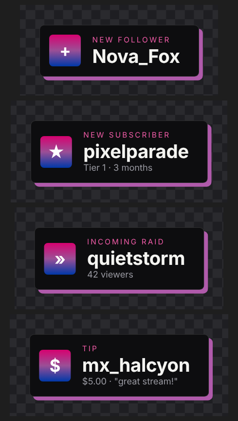
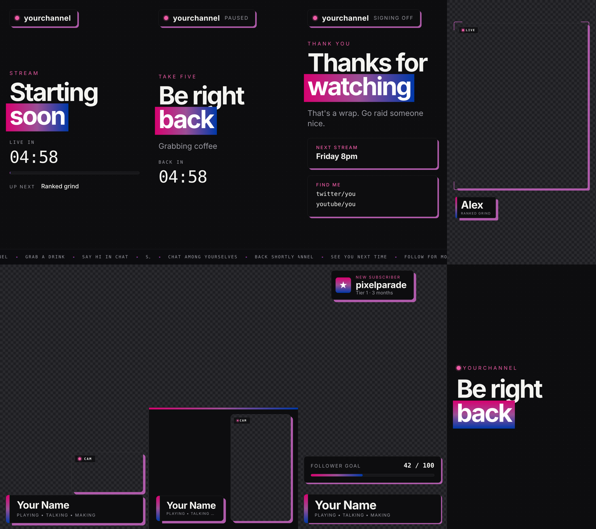
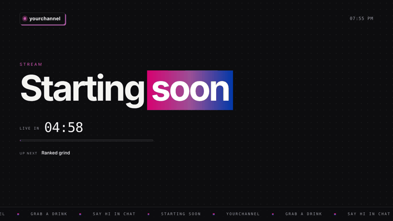
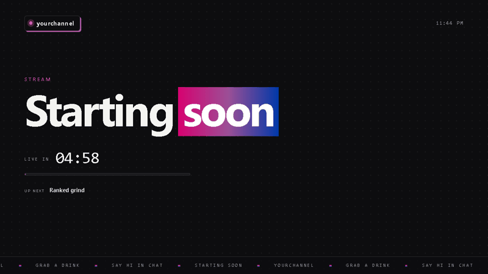
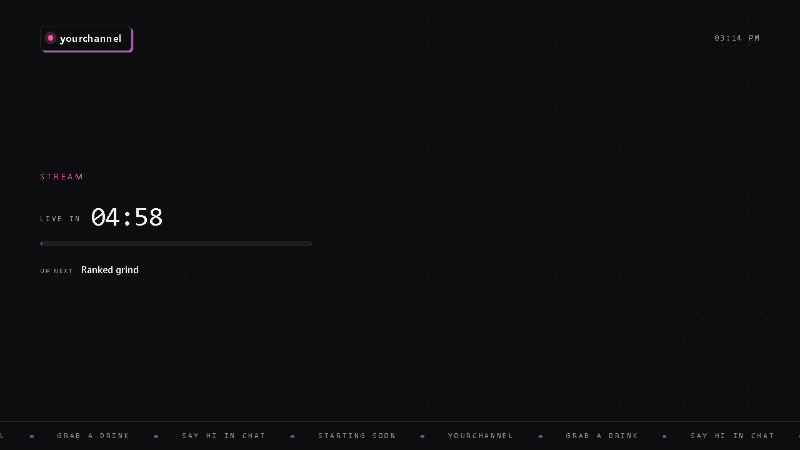
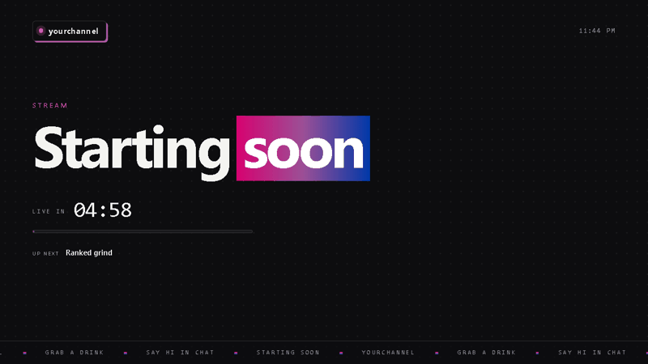
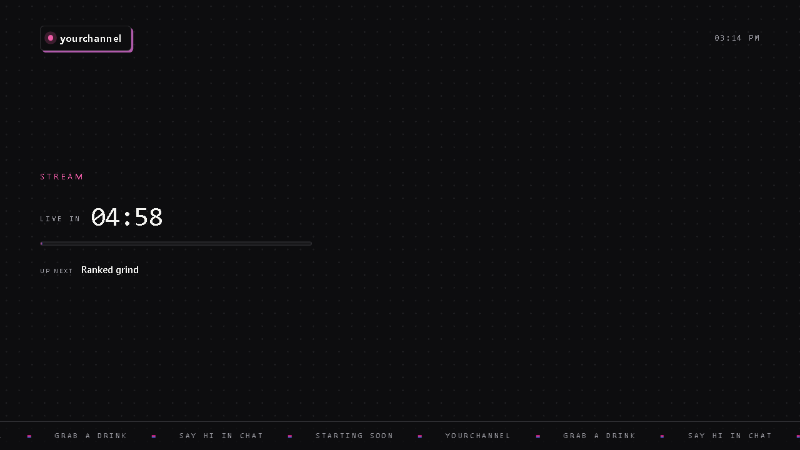

# OBS overlays

A set of browser-source overlays for OBS: scene pages, a webcam frame, screenshare layouts, alerts and
stinger transitions in seven wipe styles. Minimal dark panels with a bi-flag gradient (magenta → purple → blue)
as the one pop of color.

TypeScript for the scripts, plain HTML and CSS for the pages. `pnpm build` compiles the scripts and copies the
static pages into `public/`, which is what you open in OBS (or deploy).



## Quick start

1. Install and build: `pnpm install` then `pnpm build`. This writes the ready-to-use pages to `public/`.
2. Keep the `public/` folder together. The pages load `css/` and `js/` from next to them.
3. In OBS, add a **Browser** source, tick **Local file**, choose a page from `public/overlays/`, and set it to **1920 × 1080**
   (or **1080 × 1920** for a vertical canvas).
4. Add options to the end of the page address, for example
   `starting.html?minutes=10&next=Ranked%20grind&channel=mychannel`.

The pages use Google Fonts (Space Grotesk and Space Mono). Without an internet connection they fall back to system fonts.

## The pages

Every page switches layout by screen shape: wider than tall gets the 1920 × 1080 layout, taller than wide gets
the 1080 × 1920 layout. Both scale smoothly, so 2K and 4K look identical to 1080p.

| Page | Use it for | Background |
|---|---|---|
| `starting.html` | Starting soon, with countdown and "up next" | solid |
| `brb.html` | Be right back, counts down or counts up | solid |
| `ending.html` | Thanks for watching, next stream and socials | solid |
| `webcam.html` | Webcam frame with a nameplate | transparent |
| `screenshare.html` | Game or screen capture with a corner webcam and nameplate | transparent |
| `screenshare-side.html` | Screen on one side, full-height webcam sidebar | transparent |
| `overlay.html` | Alerts, follower goal, lower third and scene card | transparent |
| `transitions/stinger.html` | Scene transition for the Browser Transition plugin (+6 variants, below) | transparent |
| `screenshare-noname.html`, `screenshare-side-noname.html`, `overlay-noname.html` | The same without the nameplate / lower third | transparent |

Transparent pages sit **above** your sources. The webcam windows are hollow so the camera shows through.
Add `?bg=1` to any page to preview it on a checkerboard in a normal browser.

## Options

Add these to the page address. Replace spaces with `%20`.

| Option | Pages | What it does |
|---|---|---|
| `accent=FF4D8D` | all | Replaces the gradient with one flat color (hex, no `#`) |
| `channel=mychannel` | starting, brb, ending, all stingers | Channel name |
| `name=Alex`, `title=Ranked grind` | webcam, screenshare*, overlay | Nameplate / lower third text |
| `minutes=10` | starting, brb, overlay (scene card) | Countdown length. On `brb.html` leave it out to count up |
| `next=Ranked grind` | starting, ending | "Up next" / "Next stream" text |
| `msg=Grabbing coffee` | starting, brb, ending | Subtitle |
| `socials=twitter/you,youtube/you` | ending | One line per link |
| `pos=br` (`bl`, `tr`, `tl`) | screenshare | Which corner the webcam sits in |
| `cam=0` | screenshare | Hide the webcam frame |
| `side=left` | screenshare-side | Put the sidebar on the left (landscape) |
| `goal=42`, `goalMax=100`, `goalLabel=Follower goal` | overlay | Goal bar. `goal=0` hides it |
| `lower=0` | overlay | Start with the lower third hidden |
| `scene=brb` | overlay | Start with a scene card showing (`starting`, `brb`, `ending`) |
| `transparent` | starting, brb, ending | Remove the dark background |
| `word=Be right back` | all stingers | Text shown at the midpoint |

## Placing your camera and screen

The camera frames are hollow. Position and crop your webcam source to match.

**Landscape canvas, 1920 × 1080**

| Page | Webcam source |
|---|---|
| `webcam.html` | x 384, y 96, 1152 × 648 |
| `screenshare.html` (`pos=br`) | x 1392, y 762, 480 × 270 (`bl`: x 48 · `tr`: y 48 · `tl`: x 48, y 48) |
| `screenshare-side.html` | x 1464, y 96, 432 × 768 (screen fits in the left 1440 px; `side=left`: webcam x 24, screen from x 480) |
| `screenshare-noname.html` | same as `screenshare.html` |
| `screenshare-side-noname.html` | x 1464, y 156, 432 × 768 |

**Vertical canvas, 1080 × 1920**

| Page | Webcam source |
|---|---|
| `webcam.html` | x 60, y 168, 960 × 1200 |
| `screenshare.html` (`pos=br`) | x 518, y 1361, 518 × 292 (`bl`: x 43 · `tr`: y 43 · `tl`: x 43, y 43) |
| `screenshare-noname.html` (`pos=br`) | x 518, y 1585, 518 × 292 |
| `screenshare-side.html` | x 592, y 1087, 436 × 776 (bottom bar) |
| `screenshare-side-noname.html` | x 60, y 1333, 960 × 540 |



## Alerts and control

`overlay.html` shows follow, sub, raid and tip alerts one at a time (a follow also adds one to the goal).
Open it with `?bg=1` and press **1** (follow), **2** (sub), **3** (lower third), **4** (cycle scene cards),
**5** (goal +1) or **6** (hide/show goal).

From a script on the page:

```js
window.overlay.alert('raid', 'quietstorm', '42 viewers');   // 'follow' | 'sub' | 'raid' | 'tip'
window.overlay.setGoal(30, 50);
window.overlay.setLower('Alex', 'Ranked grind');
window.overlay.lower(true);                                  // show or hide the lower third
window.overlay.scene('brb', 5);                              // 'starting' | 'brb' | 'ending' | 'none', minutes
```

The same actions work with `postMessage`:

```js
postMessage({ type: 'alert', kind: 'sub', name: 'pixelparade', sub: 'Tier 1 · 3 months' }, '*');
postMessage({ type: 'goal',  value: 30, max: 50 }, '*');
postMessage({ type: 'lower', name: 'Alex', title: 'Ranked grind', show: true }, '*');
postMessage({ type: 'scene', name: 'brb', minutes: 5 }, '*');
```

An OBS browser source can't be messaged from outside, so real follower and sub alerts need a script running
inside the page (for example a StreamElements custom widget calling `window.overlay.alert`).

## Stinger transition

The stinger pages are built for the [Browser Transition](https://obsproject.com/forum/resources/browser-transition.1653/) plugin.

1. In OBS, add a **Browser Transition** under Scene Transitions.
2. Point it at a page from `public/transitions/` (Local file), 1920 × 1080.
3. Duration about 1000–1400 ms, transition point 50%. Leave **Track matte** off.

The page stays transparent until the plugin sends `transitionStart`. It wipes in, covers the screen at the
transition point (when OBS swaps scenes), then wipes out.



### Variants

Every variant shares the same ink layer, accent stripe and midpoint message — only the wipe shape changes.

| Page | Wipe |
|---|---|
| `stinger.html` | Left-to-right sweep |
| `stinger-vertical.html` | Top-to-bottom sweep |
| `stinger-diagonal.html` | Left-to-right sweep, skewed 18° |
| `stinger-diamond.html` | Left-to-right sweep, rotated 45° and enlarged |
| `stinger-radial.html` | Circle expanding from the centre |
| `stinger-iris.html` | Symmetric open from the middle outwards |
| `stinger-stepped.html` | Left-to-right sweep snapped to 12 visible steps |

| Vertical | Diagonal | Radial |
|---|---|---|
|  |  |  |

| Diamond | Iris | Stepped |
|---|---|---|
|  |  |  |

Add `?bg=1` to preview any stinger in a normal browser; it loops and replays on click. While previewing,
`duration=1200` and `tp=0.5` override the timing (OBS ignores both).

## Project layout

```
src/             sources
  overlays/      page HTML
  transitions/   stinger HTML
  css/           base.css (shared) plus one stylesheet per page
  scripts/       TypeScript (base.ts, per-page scripts, shared stinger core)
public/          build output — the pages to open in OBS (git-ignored)
docs/            preview images used in this README
tests/           Playwright page checks
types/           ambient browser-global declarations shared by the tests and tooling
scripts/         build + preview tooling (build.ts, previews.ts)
```

`tsconfig.json` drives the build (`src/scripts` → `public/js`); `tsconfig.test.json` type-checks the tests and
tooling without emitting anything.

Colors and spacing live in `src/css/base.css`; the colors are the CSS variables at the top
(`--flag-magenta`, `--flag-purple`, `--flag-blue`). One `rem` equals 1% of the screen width on a landscape
screen, so everything scales together.

## Development

```
pnpm install
pnpm build      # compiles src/scripts to public/js and copies css + html into public/
pnpm typecheck  # type-checks the Playwright tests and build tooling (emits nothing)
pnpm test       # builds, type-checks, then runs the Playwright checks against public/
pnpm previews   # builds, then regenerates the preview images in docs/
```
